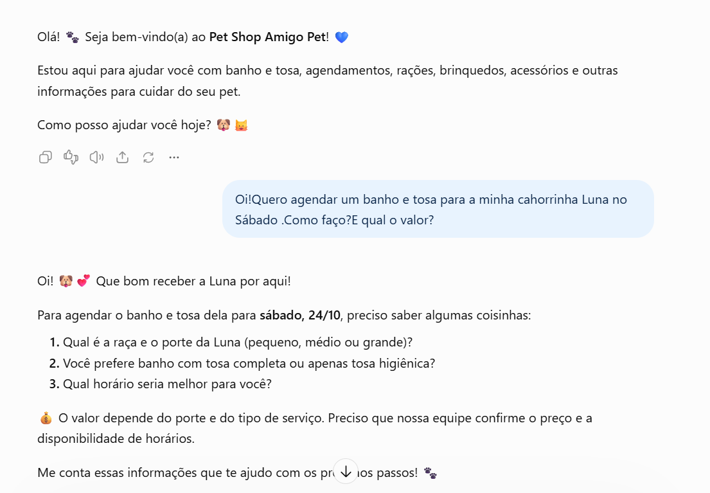
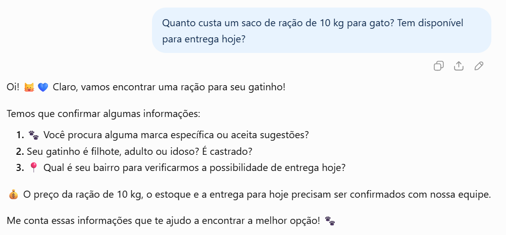
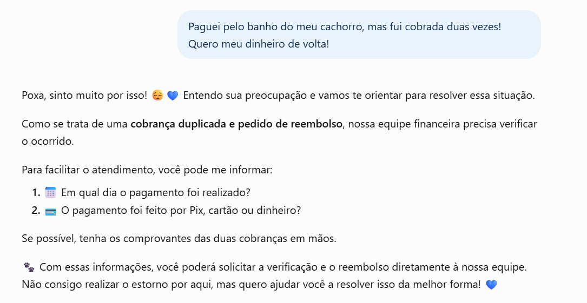

# 🐾 Agente de IA — Pet Shop Amigo Pet

## 📌 Sobre o Projeto

Este projeto foi desenvolvido durante o **Bootcamp Bradesco – Agentes de IA do Zero à Prática**, oferecido pela DIO.

O objetivo foi criar um agente de Inteligência Artificial para atendimento ao cliente de um Pet Shop, simulando conversas pelo WhatsApp.

## 🎯 Objetivo

Desenvolver um agente virtual amigável, paciente e eficiente, capaz de:

- Auxiliar no agendamento de banho e tosa.
- Informar sobre produtos, serviços e disponibilidade.
- Orientar clientes sobre rações e acessórios.
- Identificar oportunidades de venda sem pressionar o cliente.
- Encaminhar situações mais complexas para atendimento humano.

## 🛠️ Desenvolvimento

O projeto foi dividido em três etapas:

1. **Definição do agente:** público-alvo, canal de atendimento e principais solicitações.
2. **Criação das regras:** tom de voz, formato das respostas e limites de atuação.
3. **Testes:** simulação de diferentes situações para avaliar o comportamento do agente.

📄 **[Clique aqui para visualizar o prompt completo do agente](Rascunhodeumagente.md)**

## 🧪 Testes Realizados

Foram realizados três testes para verificar se o agente seguia corretamente as instruções.

### 🐶 Teste 1 — Agendamento de Banho e Tosa

O agente orientou sobre o agendamento, solicitou informações necessárias e não inventou preços ou horários.

### 🐱 Teste 2 — Consulta de Preços e Disponibilidade

O agente reconheceu que não tinha acesso aos preços e ao estoque, orientando a confirmação com a equipe.

### 💳 Teste 3 — Reclamação de Cobrança Duplicada

O agente demonstrou empatia, explicou suas limitações e orientou o encaminhamento para atendimento humano.

## 💡 Aprendizados

Com este desafio, pratiquei conceitos de Engenharia de Prompt e aprendi a importância de definir instruções claras, regras e limitações para o funcionamento de agentes de IA.

Também pude observar como a Inteligência Artificial pode contribuir para melhorar o atendimento ao cliente e otimizar processos.

## 🚀 Tecnologias e Conceitos

- Inteligência Artificial Generativa
- Engenharia de Prompt
- Agentes de IA
- Atendimento ao Cliente
- Experiência do Usuário (UX)

---

**Projeto desenvolvido para fins educacionais | Bootcamp Bradesco – DIO**
